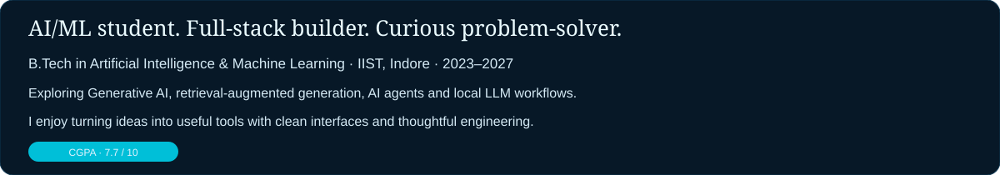
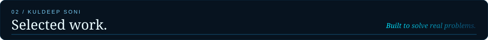
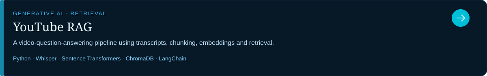
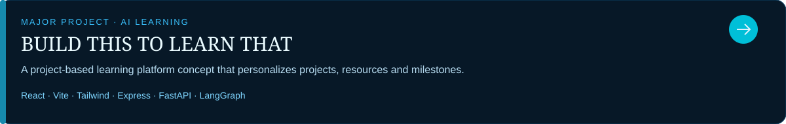
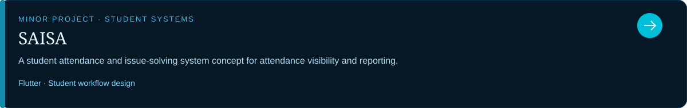
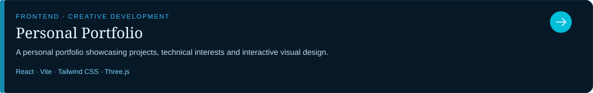
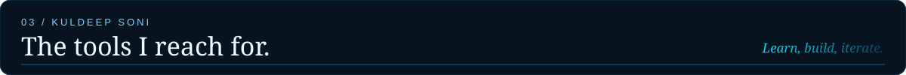
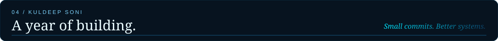

  
  
  

I'm a B.Tech student in **Artificial Intelligence & Machine Learning** who enjoys building practical software and exploring how AI systems work under the hood. My current interests include **Generative AI, RAG pipelines, AI agents, local LLMs, and full-stack development**.

- Currently pursuing B.Tech in AI & ML at **Indore Institute of Science and Technology (IIST), Indore**.
- Learning by building projects, testing ideas, and documenting what I discover.
- Interested in AI engineering, retrieval systems, agentic workflows, and developer tools.
- Portfolio: [kuldeep-soni.vercel.app](https://kuldeep-soni.vercel.app/)

  
  

<table>
  <tr>
    <td width="50%" valign="top">
      <strong>Languages</strong>  
      C · C++ · Python · Java · JavaScript
    </td>
    <td width="50%" valign="top">
      <strong>AI / ML</strong>  
      Generative AI · RAG · Embeddings · Vector Search · AI Agents
    </td>
  </tr>
  <tr>
    <td width="50%" valign="top">
      <strong>Web Development</strong>  
      React · Node.js · Express · HTML · CSS · Tailwind CSS · Vite
    </td>
    <td width="50%" valign="top">
      <strong>Tools &amp; Data</strong>  
      Git · GitHub · ChromaDB · MongoDB · MySQL · REST APIs
    </td>
  </tr>
</table>

  
  

  

I'm always happy to connect with people who enjoy building, experimenting, and learning in public.

**Building intelligent systems, one project at a time.**

